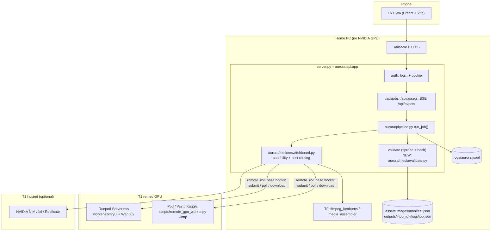
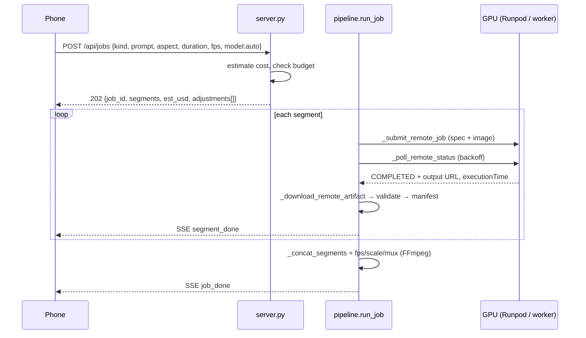
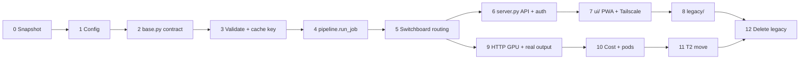

# Project Aurora v2 — Target Architecture

| | |
|---|---|
| Role | Solution Architect · 2026-10-20 · Status: proposed |
| Inputs | [REQUIREMENTS.md](REQUIREMENTS.md), [research/GPU_BACKENDS.md](research/GPU_BACKENDS.md), [UI_SPEC.md](UI_SPEC.md), [SETUP_AUDIT.md](SETUP_AUDIT.md), [TEST_PLAN.md](TEST_PLAN.md) |
| Principle | **Reuse first.** Extend existing modules in place. A new file is proposed only when nothing existing fits (marked **NEW**). |

---

## 1. Current state

### 1.1 Entry points

| Entry point | What it does | Verdict |
|---|---|---|
| `main.py` | Pipeline A: Ollama script → image (`CacheGate` + `backend/.../image_switchboard.py`) → motion (`src/modules/motion_engine.py` → `aurora/motion/switchboard.py`) or local ComfyUI SVD → XTTS → Wav2Lip → `media_assembler.py`. Adds `src` to `sys.path` (line 42). | Only the FFmpeg path works here. Hard-codes anime style tags, 5 s, 1080x1920 and fixed `choices=` lists. |
| `server.py` (+ `aurora/api.py`, which only re-exports it) | FastAPI on `127.0.0.1:8000`. Spawns `python main.py` / `scripts/render_from_asset.py` as a subprocess per job. One global `_active_process`. SSE of stdout. Status read from `outputs/log.json`. | Works. No auth, `CORS *`, one job at a time, state lost on restart. `os.startfile` is Windows-only. |
| `scripts/launch.py` | Runs `uvicorn aurora.api:app --host 0.0.0.0` + Streamlit. Requires `NVIDIA_API_KEY`. | Exposes the unauthenticated API on all interfaces. |
| `streamlit_app.py` | Desktop dashboard calling `server.py`. | Third UI; poor on a phone. |
| `ui/index.html`, `ui/main.js` | Vanilla dashboard. `API_URL` hard-coded to `127.0.0.1` (`ui/main.js:4`). | Cannot work from a phone. `ui/src/*` is Vite starter leftovers. |
| `aurora/pipeline.py` | Pipeline B CLI: Ken Burns single shot, or `--prompt-ledger` segments + FFmpeg concat. | Real, but **segment `prompt` is only logged, never used**. |
| `scripts/remote_gpu_worker.py` | GPU-host folder watcher. Engines: LivePortrait, SVD-XT (diffusers), FramePack, Wan2GP (`WAN2GP_COMMAND`). `--mock` copies one MP4. | Real engine code, **never run on a GPU**. Writes `SUCCESS`, but the HTTP hook path expects `COMPLETED` (GPU_BACKENDS §6). |
| `scripts/gpu_provision.sh` | Linux GPU bootstrap (venv, SVD-XT, FramePack). | Untested; good base. |
| Batch: `scripts/batch_processor.py`, `src/batch_orchestrator.py`, `run_anime_batch.bat` | Three loops over `main.py`. | Duplicates. |
| Harnesses: `scripts/benchmark_i2v.py`, `scripts/triple_shot_identity_test.py`, `test_motion_routing.py`, `test_wan2gp_handshake.py` | Validated routing and **mocked** success. | Keep only as contract-test ideas. |
| `src/first_light.py`, `preflight_check.py`, `verify_setup.py`, `inspect_workflow.py`, `download_models.py`, `ollama_fix.py`, `src/test_*.py` | Setup tools for a local NVIDIA + ComfyUI. | Dead on this PC. |
| `tests/test_sprint1.py`, `tests/test_prompt_ledgers.py` | CPU pytest (6 pass per SETUP_AUDIT). | Keep. |

### 1.2 Real vs mock vs dead

**Mock proof.** All 10 provider "success" MP4s in `outputs/i2v_responses/` and `outputs/liveportrait_responses/` have the same MD5, `9a75c418…`. The 11th file is `wan_mock_success_wan2gp_provider.mp4`. **No AI video was ever generated.** Two causes: `switchboard.py` labels any returned file `generative_motion`, and `remote_i2v_base.wait_for_response` accepts any non-empty file.

| Module | Status | Note |
|---|---|---|
| `aurora/motion/providers/ffmpeg_kenburns.py`, `ffmpeg_static.py` | Real | Two FFmpeg providers. `ffmpeg_static` is fixed at 1080x1920 / 25 fps. `ffmpeg_kenburns` has a different `generate()` signature. |
| `src/modules/media_assembler.py` | Real | Concat, mux, upscale. Fixed "reels" targets. |
| `aurora/assets/manifest.py` (`ManifestManager`) | Real | Atomic JSON, schema repair, lineage, motion variants. |
| `aurora/assets/cache_gate.py` | Real, misused | `main.py` keys on `topic` but generates from topic + tags + LLM hook. `manifest.composite_asset_key` is a **second, different** key. |
| `aurora/logs/logger.py` (`StructuredLogger`) | Real | Rule 4 fields → `logs/aurora.jsonl`. The worker and `config.yaml` write root `aurora.jsonl` instead. |
| `aurora/monitoring/observability.py`, `src/modules/pipeline_logger.py` | Real | Two more state sinks: `outputs/telemetry/` and `outputs/log.json`. |
| `backend/app/providers/nvidia_nim.py` | **Real (T2)** | The only AI generation that ever worked (T2I). |
| `backend/app/providers/local_comfyui.py`, `src/modules/comfy_orchestrator.py` | Real code, no GPU | Useful against ComfyUI on the GPU host. |
| `aurora/motion/providers/wan2gp_provider.py` | HTTP client, unused | Real submit → poll → download. **Template for all remote providers.** |
| `framepack_provider.py`, `svdxt_provider.py` | Stubs (7 lines) | Name only; file-drop. |
| `liveportrait_provider.py`, `remote_i2v_base.py` file-drop branch | Mock-only | Needs a shared folder PC↔GPU that never existed. |
| `src/modules/video_engine.py`, `audio_engine.py`, `lipsync_processor.py`, `llm_manager.py` | Dead here | Local GPU or Ollama (Rule 1 says FreeLLMAPI). |

### 1.3 Problems to fix

1. Two pipelines and three UIs; no single job owner.
2. Fake success: no output validation.
3. The file-drop GPU contract needs shared storage that does not exist.
4. Hard-coded size, duration, fps, style tags and keyword routing (`switchboard._select_provider_key`: "combat" → FramePack).
5. No auth; desktop-only UI.
6. State scattered over 5 files/dirs; `cost_usd` is always 0.
7. `config.yaml` describes a 12 GB NVIDIA box that does not exist.

---

## 2. Target architecture

### 2.1 Decisions

| Area | Decision | Reuse |
|---|---|---|
| Package | `aurora/` survives. `src/` and `backend/` code is moved into it, not rewritten. | Reuse `aurora/*`; `git mv` the useful `src/`/`backend/` modules. |
| API | **One FastAPI app = `server.py`, refactored in place** and exposed as `aurora.api:app`. Subprocess-per-job is replaced by an in-process job runner. | Reuse `server.py` routes (`/api/jobs`, `/api/assets`, `/api/providers/status`, `/api/status`, `/api/metrics`, SSE). |
| Job runner | Extend `aurora/pipeline.py` from a CLI into the runner: `run()` / `run_prompt_ledger()` become one `run_job(job)`, called from a background asyncio task. | Reuse its ledger loader, segment loop and `_concat_segments`. |
| Providers | Extend `aurora/motion/base.py` into the one provider contract for image/video/audio (add `capabilities()`, unify `generate()`). | `MotionProvider` already has `name`, `tier`, `priority`, `is_available`, `estimated_cost_usd`, `estimated_time_secs`. |
| Routing | Extend `aurora/motion/switchboard.py`: replace keyword selection with capability + cost ordering; keep its lazy registry, fallback, `_release_provider`, telemetry and `register_motion_variant`. Fold `backend/.../image_switchboard.py` into it later. | Reuse switchboard as-is minus `_select_provider_key`. |
| GPU contract | **HTTP via the existing hooks in `remote_i2v_base.py`** (`_submit_remote_job`, `_poll_remote_status`, `_download_remote_artifact`). Primary: Runpod Serverless `/run` + `/status` (GPU_BACKENDS §5). Self-hosted pod: add an HTTP mode to `scripts/remote_gpu_worker.py` with the same shapes. Remove the file-drop branch. | Reuse `wan2gp_provider.py` HTTP code (move it into the base), worker engines, error types. |
| Storage | Keep `ManifestManager` JSON for assets (`assets/images/manifest.json`). Jobs stored as one JSON per job at `outputs/<job_id>/logs/job.json` (already written by `remote_i2v_base._update_job_metadata`). SQLite only if listing gets slow (ADR-004). | Reuse `ManifestManager._write_atomic` for jobs too. |
| Cache key | One function: `CacheGate.generate_asset_key`, extended. Delete `manifest.composite_asset_key`. | Reuse `cache_gate.py`. |
| Logging | One sink: `StructuredLogger` → `logs/aurora.jsonl`. | Reuse `aurora/logs/logger.py`. |
| UI | One UI: `ui/` rebuilt as a Preact + Vite PWA (UI_SPEC §11), built to `ui/dist` and served by `server.py`. Streamlit removed. | Reuse `ui/` tooling, `style.css` tokens and the `server.py` endpoints. |
| Remote access | Tailscale → `127.0.0.1:8000`, plus app login (SETUP_AUDIT §7, UI_SPEC §9). | Reuse `server.py` + `ui/`; no new server. |
| Config / secrets | `config.yaml` extended in place; `.env` loaded via `pydantic-settings` (already pinned). | Reuse `config.yaml`, `.env.example`. |
| Docs | Update `AURORA.md` (status, rules, exit criterion #2 met) instead of a new README. | Reuse `AURORA.md`. |

### 2.2 Component diagram



### 2.3 Job flow



### 2.4 Target layout (moves, not rewrites)

| Target | Source |
|---|---|
| `aurora/api.py` | Keep the alias; `server.py` stays the implementation until step 8, then `git mv server.py aurora/server.py`. |
| `aurora/pipeline.py` | Same file, extended (`run_job`, planner helpers). |
| `aurora/motion/base.py` | Same file, extended (`Capability`, `GenParams`). |
| `aurora/motion/switchboard.py` | Same file, extended. |
| `aurora/motion/providers/remote_i2v_base.py` | Same file; HTTP from `wan2gp_provider.py` becomes the default. |
| `aurora/motion/providers/runpod_provider.py` **NEW** (~60 lines) | Subclass of `RemoteI2VProvider` (Runpod `/run` + `/status`). |
| `aurora/motion/providers/nvidia_nim.py`, `local_comfyui.py` | `git mv` from `backend/app/providers/`. |
| `aurora/media/assemble.py` | `git mv src/modules/media_assembler.py`. |
| `aurora/media/validate.py` **NEW** (~80 lines) | No equivalent exists. |
| `aurora/gpu_pods.py` **NEW** (~80 lines) | Pod start/stop/idle-shutdown (not needed for Runpod Serverless). |
| `scripts/remote_gpu_worker.py` | Same file; add `--http` mode (FastAPI) beside the folder loop, then drop the folder loop. |
| `scripts/gpu_provision.sh` | Same file; add Wan 2.2 repos (GPU_BACKENDS §7b). |
| `ui/` | Same folder; new `ui/src/screens/*` per UI_SPEC. |

---

## 3. Core interfaces

### 3.1 Job model (extend `aurora/pipeline.py`; reuse the ledger schema of `aurora/prompts/titan_battle_60s.json`)

| Field | Type | Notes |
|---|---|---|
| `id` | str | Reuse the `StructuredLogger.job_id` format. |
| `kind` | `t2i` · `i2i` · `t2v` · `i2v` · `v2v` · `still_motion` · `ledger` · `audio` | Replaces `MotionMode` + `--mode`/`--motion-mode`. Extend the `MotionMode` enum in `base.py` rather than adding a new one. |
| `params` | `GenParams` | `prompt, negative_prompt, width, height, aspect_ratio, duration_secs, fps, seed, steps, cfg, quality, camera_motion, style, loras, num_outputs, output_format, extra{}`. All optional; `None` = model native. |
| `inputs` | list of asset keys / uploads | Reuse manifest `asset_key`. |
| `model` / `tier` / `provider` | `"auto"` or forced | Rule 3 when `auto`. |
| `segments[]` | `{index, prompt, duration_secs, seed, camera_motion, input, continuity: none·last_frame·reference, status, output, attempts}` | Same as today's ledger `segments` (`start_frame`/`end_frame` still accepted via `_segment_int`). **The prompt is now passed to the provider.** |
| `allow_still_fallback` | bool, default false | Ken Burns stands in for AI video only if this is true. |
| `max_cost_usd` | float? | Per-job cap. |
| `status` | `queued · waiting_gpu · running · assembling · succeeded · succeeded_with_fallback · failed · cancelled · blocked_budget` | |
| `adjustments[]` | `{field, requested, used, reason}` | "Never silently override" (REQUIREMENTS §5). |
| `outputs[]`, `cost_usd`, `error{type, message, retryable, provider, stderr_tail, exit_code}` | | Error fields reuse `RemoteWorkerCrashError` and `_format_remote_failure`. |

Planner rules, added as functions in `pipeline.py`:

- **Size:** snap `aspect_ratio` to the model's `size_step` / `max_pixels`, and record an adjustment.
- **Duration:** if `duration > max_clip_secs`, split into equal segments.
- **FPS:** generate at native fps, then FFmpeg `minterpolate` or resample.
- **Continuity:** `last_frame` reuses `main._extract_first_frame`, changed to take the last frame.
- **Resume:** done segments are never re-run.

### 3.2 Provider contract (extend `aurora/motion/base.py`)

Add to `MotionProvider`. Keep the class name for now; rename to `Provider` at step 12.

```python
class Capability(BaseModel):          # values come from config.yaml, filled by ML/GPU infra
    model: str; kinds: set[str]; tier: Literal["local","free","cheap","premium"]  # reuse ExecutionTier
    max_clip_secs: float | None; native_fps: int | None
    size_step: int = 16; min_side: int; max_side: int; max_pixels: int
    supports_negative: bool; supports_seed: bool; supports_camera: bool; supports_lora: bool
    min_vram_gb: float | None; cold_start_secs: float | None
    est_secs_per_output_sec: float
    pricing: dict                      # {"per_gpu_hour": 1.10} | {"per_second_output": 0.08} | {"per_image": 0.003}
    content_policy: Literal["none","provider"]
    is_mock: bool = False

class MotionProvider(ABC):             # existing fields kept: name, mode, tier, priority
    def capabilities(self) -> list[Capability]: ...           # NEW method
    def is_available(self) -> bool: ...                       # exists
    def estimated_cost_usd(self, job_or_secs) -> float: ...   # exists, now uses pricing
    def estimated_time_secs(self, job_or_secs) -> float: ...  # exists
    def generate(self, params: GenParams, inputs: list[Path], job_id: str) -> MotionResult: ...  # unified
```

- Unify the two signatures, `FFmpegKenBurns.generate(output_path, duration_secs)` and `MotionProvider.generate(image_path, duration, …)`, behind `GenParams`. Keep the old kwargs as a shim until `main.py` is retired.
- Extend `MotionResult` / `VideoResult` (keep both until merged) with `seed_used`, `model_version`, `gpu_seconds` and `cost_usd`.
- Image providers: add `capabilities()` to `backend/app/providers/base.py` `ImageProvider` now, and merge into `MotionProvider` when moved (step 11).

### 3.3 Switchboard tier routing (extend `aurora/motion/switchboard.py`)

| Step | Behaviour | Change vs today |
|---|---|---|
| Filter | Providers whose `capabilities()` support `kind`, the snapped size and duration; honour forced `model`/`tier`/`provider`. | Replaces `_select_provider_key` keyword rules. |
| Order (`auto`) | `local` (FFmpeg: still_motion / assembly only) → `free` (Kaggle) → `cheap` (Runpod/Vast pod) → `premium` (Runpod Serverless 48/80 GB, Modal, fal/Replicate/NIM), then by estimated cost, then time. | Same tier enum (`ExecutionTier`); matches GPU_BACKENDS §5 mapping. |
| Retry | 2 retries for retryable errors (`TIMEOUT`, 5xx, `CUDA_OOM` → smaller size if allowed). | AURORA Rule 5; today there are 0 retries. |
| Fallback | Next provider in order; log `fallback_provider`. Ken Burns **only if `allow_still_fallback`** → `succeeded_with_fallback`. | Today it silently degrades to `static_cinematic` with `badge="Motion R&D"`. |
| Refusal | T2 `CONTENT_REFUSED` → no retry on another T2; UI offers T1. | NEW error type. |
| Budget | Block before submit if month spend + estimate > cap. | NEW. |
| Release | `_release_provider` after each task. | Kept. |

### 3.4 Remote GPU contract (replaces file-drop)

Reuse the three hooks in `remote_i2v_base.py` plus `_wait_for_remote_completion`. Change the base so that `_submit_remote_job` returning `None` is an **error**, not a fallback to file-drop.

| Hook | Runpod Serverless (primary) | Self-hosted `remote_gpu_worker.py --http` |
|---|---|---|
| submit | `POST /v2/{endpoint}/run` `{input: spec}`; image as base64 or presigned URL | `POST /v1/tasks` multipart `spec` + `source_image` (same field names as `wan2gp_provider.py`) → `{task_id}` |
| poll | `GET /v2/{endpoint}/status/{id}` → `IN_QUEUE`/`IN_PROGRESS`/`COMPLETED`/`FAILED` | `GET /v1/tasks/{id}` → `{status, progress, error_type, stderr_tail, gpu metrics}` |
| download | Output URL (S3 / network volume) from status | `GET /v1/tasks/{id}/artifact` |
| health | Runpod `/health` | `GET /v1/health` → GPU, VRAM, loaded models, `is_mock` |
| auth | `RUNPOD_API_KEY` bearer | `AURORA_WORKER_TOKEN` bearer |

`spec` reuses today's payload field names (`request_id, asset_key, seed, identity_lock, duration_sec, motion_prompt, provider`) plus `GenParams` and `model`. Absolute local paths (`source_image`, `expected_output`) are dropped.

Rules:

- **Status mapping:** worker `SUCCESS` and Runpod `COMPLETED` both map to `COMPLETED` in `_poll_remote_status` (fixes the mismatch in GPU_BACKENDS §6).
- **Timeouts:** `wait_for_remote_response_sec` becomes per-capability (`cold_start + est × 3`, ≥ 900 s for Wan), not 120 s. Poll backoff goes from 2 s to 10 s.
- **Idempotency:** `request_id` is the idempotency key; resubmitting it returns the same task.
- **Integrity:** the worker returns the `sha256` of each artifact; the client verifies it.
- **No mocks in production:** `--mock` stays, but the worker then reports `is_mock: true` in health and status, and the client rejects it unless `AURORA_ENV=test`.
- **Kaggle:** if kept, it can't expose HTTP, so its notebook polls `server.py` (`GET /api/worker/next`, `POST /api/worker/{id}/result`) with the worker token. Build this only if ML infra keeps Kaggle.

---

## 4. Storage, assets, logging, secrets, cost

### 4.1 Storage and assets

| Item | Decision | Reuse |
|---|---|---|
| Asset index | `assets/images/manifest.json` via `ManifestManager`; add video/audio records (rename the file to `assets/manifest.json` at step 12) | `register_asset`, `register_motion_variant`, lineage, `sanitize_asset_record` |
| Files | Keep `outputs/<job_id>/…` per job; dedupe by sha256 in the manifest (`image_hash` already exists) | `outputs/` layout |
| Job state | `outputs/<job_id>/logs/job.json`, written atomically | `_update_job_metadata`, `ManifestManager._write_atomic` |
| Job list | `server._collect_jobs()` scans job dirs | Reuse. Move to SQLite only if > ~2k jobs or slow (ADR-004). |
| Cleanup | `outputs/*_requests`, `*_responses`, `*_archived_requests`, `wan_mock_success` deleted after their hashes go into the blocklist | AURORA.md already allows deleting `outputs/raw`, `outputs/final` |

**Cache key.** Extend `CacheGate.generate_asset_key` components to:

`op, kind, model, model_version, workflow_version, normalized prompt, negative, width x height, fps, duration, seed, steps, cfg, loras, input sha256s`.

- Remove `provider` (the same model on Runpod or Vast gives the same output) and `style_preset`.
- Key on **exactly what is sent to the provider**, not `topic`.
- A random seed means no cache hit.
- Reuse is a per-job choice (REQUIREMENTS §6 drops Rule 2).
- Delete `manifest.composite_asset_key`; switch `image_switchboard.py` to `CacheGate`.

### 4.2 Output validation gate (**NEW** `aurora/media/validate.py`)

Called by `pipeline.run_job` before `register_asset`. Fail → `VALIDATION_FAILED` (one retry), never success.

1. The file exists, size > 0, and its sha256 matches what the worker reported.
2. `ffprobe` (reuse `server._probe_video` / `_ffprobe_path`) gives the expected stream type, size ± `size_step`, duration ± 10 %, fps ± 1.
3. The sha256 is not in the blocklist: the known mock files (MD5 `9a75c418…` and `wan_mock_success_wan2gp_provider.mp4`).
4. It is not identical to an input or to another request's output.
5. Video only: 3 sampled frames are not all identical.

### 4.3 Logging and observability

| Keep | Change |
|---|---|
| `StructuredLogger` (`aurora/logs/logger.py`), Rule 4 fields | Single path `logs/aurora.jsonl`; set `aurora_log` in `config.yaml` and the worker's mirror log to it. Add `model, seed, width, height, fps, segment_id, fallback_provider, task_id, gpu_seconds`. Rotate at 50 MB. |
| `TelemetryCollector` (`aurora/monitoring/observability.py`) | Keep for stage timing; later write it into `job.json` instead of `outputs/telemetry/`. |
| `server.py` SSE (`/api/logs/stream`) | Becomes `/api/events` (job events from the runner, not subprocess stdout). |
| Worker `GPUMonitor`, `collect_gpu_metrics`, `_classify_error_type` | Returned in poll status; copied into the client log. |
| Retire | `src/modules/pipeline_logger.py` (`outputs/log.json`), root `aurora.jsonl`. |

### 4.4 Secrets

- **Location:** all secrets live in `.env`, loaded by `pydantic-settings`. Never in `config.yaml`, logs or API responses. The API reports only "key present", as `/api/providers/status` does today.
- **New variables for `.env.example`:**
  - `AURORA_ADMIN_PASSWORD_HASH`, `AURORA_SESSION_SECRET`, `AURORA_WORKER_TOKEN`
  - `RUNPOD_ENDPOINT_ID`, `HF_TOKEN` (GPU host only)
  - Already listed: `RUNPOD_API_KEY`, `VAST_API_KEY`, `MODAL_TOKEN_*`, `KAGGLE_*`, `NVIDIA_API_KEY`, `REPLICATE_API_TOKEN`, `FREELLMAPI_KEY`
- **GPU host:** secrets are set as Runpod/Modal secret env vars, never baked into images. `gpu_provision.sh` already never prints them.
- **Launch:** `scripts/launch.py` no longer requires `NVIDIA_API_KEY`.

### 4.5 Cost tracking

| Piece | How | Reuse |
|---|---|---|
| Estimate | `provider.estimated_cost_usd()` from `Capability.pricing`; shown before submit (`POST /api/jobs/estimate`, UI_SPEC §12) | Existing method |
| Actual | Runpod `executionTime` × rate; worker `gpu_seconds` × rate; T2 billed amount. Written as `cost_usd` per task to `job.json` and `aurora.jsonl` | Rule 4 `cost_usd` field |
| Pod idle cost | **NEW** `aurora/gpu_pods.py` logs pod start/stop; idle time is billed as a cost row with no task. Idle shutdown after 10 min (config); hard stop at `max_pod_hours` (default 2) | Runpod/Vast keys from `.env` |
| Budget | Month spend = sum of `cost_usd` in job files for the month. Block on cap (`blocked_budget`). `GET/PUT /api/budget` | `_collect_jobs()` |
| Reconcile (Phase 2) | Pull Runpod billing daily, correct estimates | — |

---

## 5. Remote access from the phone, and auth

| Option | Verdict |
|---|---|
| **Tailscale** (`tailscale serve --https=443 http://127.0.0.1:8000` → `https://<pc>.<tailnet>.ts.net`) | **MVP choice.** Free, no open ports, real HTTPS (needed by the PWA), only your devices. PC must stay awake during jobs. |
| Cloudflare Tunnel + Access | Alternative for a browser without Tailscale. Needs a domain; 100 MB upload limit on free. |
| API hosted next to the GPU / on a VPS | Phase 3, if access is needed while the PC is off. Possible once `os.startfile` is removed. |
| Router port forward | Rejected. |

**Auth** (implemented in `server.py`, matching UI_SPEC §9):

- Owner username/password; argon2 hash in `.env`; first-run setup token printed to the console.
- `HttpOnly; Secure; SameSite=Lax` session cookie (30 days) plus a CSRF header on mutating requests.
- Rate limit: lockout after 5 failed logins.
- Hashed, revocable API tokens for scripts.
- Same origin (`server.py` serves `ui/dist`), so the `CORSMiddleware(allow_origins=["*"])` is removed.
- Bind to `127.0.0.1` only, including in `scripts/launch.py`.
- Shared media links are signed and expire.
- The GPU worker uses its own bearer token, and its URL is never sent to the phone.

---

## 6. Migration plan

Small steps; each keeps `python -m pytest tests -q` green. Old code moves to `legacy/` before deletion. No GPU spend before step 9.

| # | Step | Files (reuse first) | Done when |
|---|---|---|---|
| 0 | Snapshot: commit current work on a branch, tag `v1-hibernated`, back up the manifest (user decision) | git | Tag exists |
| 1 | Config truth: extend `config.yaml` (remove fake 12 GB box, fixed 9:16/5 s; add `providers.*.capabilities`); load `.env`; extend `.env.example` | `config.yaml`, `.env.example`, `AURORA.md` | Config matches reality |
| 2 | Contract: add `Capability`, `GenParams`, `capabilities()` and the unified `generate()` to `aurora/motion/base.py`; merge the two FFmpeg providers into `ffmpeg_kenburns.py` (any size/fps/duration) | `base.py`, `ffmpeg_kenburns.py`, `ffmpeg_static.py` | Ken Burns at 16:9 / 1:1 / 9:16, any length |
| 3 | Validation + cache key: **NEW** `aurora/media/validate.py`; extend `CacheGate.generate_asset_key`; remove `composite_asset_key` | `cache_gate.py`, `manifest.py`, `image_switchboard.py` | Mock MP4 rejected; key tests pass |
| 4 | Runner: extend `aurora/pipeline.py` with `run_job` (planner, segment prompts used, retries, resume); `git mv src/modules/media_assembler.py aurora/media/assemble.py` | `pipeline.py` | 60 s ledger runs with T0 + mock T1 in tests |
| 5 | Router: replace `_select_provider_key` with capability/cost ordering, opt-in still fallback, budget check | `switchboard.py` | Routing tests (move root `test_*.py` into `tests/`) |
| 6 | API: in `server.py`, swap subprocess spawning for `run_job` background tasks; add auth, `/api/events`, `/api/jobs/estimate`, `/api/budget`; serve `ui/dist`; bind 127.0.0.1 | `server.py`, `scripts/launch.py` | Job via API without `main.py`; login required |
| 7 | UI + access: rebuild `ui/` per UI_SPEC; Tailscale serve (DevOps runbook) | `ui/` | Create / watch / download works from the phone |
| 8 | Retire: move `main.py`, `streamlit_app.py`, `src/` (rest), `backend/services`, batch scripts, `run_anime_batch.bat`, `presets.json` to `legacy/`; `git mv server.py aurora/server.py` | moves | Nothing imports `legacy/` |
| 9 | GPU: `remote_i2v_base.py` HTTP default (code from `wan2gp_provider.py`), status mapping; **NEW** `runpod_provider.py`; `remote_gpu_worker.py --http`; `gpu_provision.sh` + Wan 2.2 | providers, worker | **One real T2I and one real I2V** pass the validation gate |
| 10 | Cost: **NEW** `aurora/gpu_pods.py`, budget UI | | Idle pod stops itself; cap blocks a job |
| 11 | T2: `git mv backend/app/providers/{nvidia_nim,local_comfyui}.py aurora/motion/providers/`; add `capabilities()` | | NIM T2I behind the same switchboard |
| 12 | Delete `legacy/` after 2–4 weeks; rename `MotionProvider` → `Provider`, `aurora/motion` → `aurora/providers` (optional) | | One pipeline, one API, one UI |
| 13 | Phase 2: audio/TTS as worker engines (reuse `audio_engine.py` code there), V2V, LLM ledgers via FreeLLMAPI (reuse `llm_manager.py`, point at `localhost:3001/v1`), presets, LoRAs | | REQUIREMENTS §10 |



Steps 6–7 and step 9 can run in parallel after step 5.

### 6.1 File list

**Keep and extend in place:** `aurora/pipeline.py`, `aurora/motion/base.py`, `aurora/motion/switchboard.py`, `aurora/motion/providers/remote_i2v_base.py`, `ffmpeg_kenburns.py`, `aurora/assets/manifest.py`, `aurora/assets/cache_gate.py`, `aurora/logs/logger.py`, `aurora/monitoring/observability.py`, `aurora/api.py`, `server.py`, `ui/`, `scripts/remote_gpu_worker.py`, `scripts/gpu_provision.sh`, `scripts/launch.py`, `config.yaml`, `.env.example`, `AURORA.md`, `tests/*`, `assets/images/*`, `aurora/prompts/titan_battle_60s.json` (as an example ledger).

**Move (`git mv`), then extend:**

| From | To |
|---|---|
| `src/modules/media_assembler.py` | `aurora/media/assemble.py` |
| `backend/app/providers/nvidia_nim.py`, `local_comfyui.py` | `aurora/motion/providers/` |
| `src/modules/comfy_orchestrator.py` | Used by the GPU worker (ComfyUI on the pod) |
| `src/workflows/*.json` | Next to the worker; replaced by Wan 2.2 workflows |
| `test_motion_routing.py`, `test_wan2gp_handshake.py` | `tests/`, rewritten for capability routing |
| `src/modules/llm_manager.py`, `audio_engine.py` | Phase 2 (FreeLLMAPI; worker TTS) |

**Merge, then delete:**

| File | Merged into |
|---|---|
| `wan2gp_provider.py` | `remote_i2v_base.py` (its HTTP code) |
| `framepack_provider.py`, `svdxt_provider.py` | Config entries for one remote provider class |
| `backend/app/services/image_switchboard.py`, `src/modules/motion_engine.py` | `switchboard.py` |
| `backend/app/providers/base.py` | `motion/base.py` |
| `ffmpeg_static.py` | `ffmpeg_kenburns.py` |
| `src/modules/pipeline_logger.py` | `StructuredLogger` + `job.json` |
| `main.py` | `pipeline.run_job` |
| `scripts/render_from_asset.py`, `scripts/batch_processor.py`, `src/batch_orchestrator.py` | API: job from asset / many jobs |

**Delete:**

| File | Reason |
|---|---|
| `streamlit_app.py` | One UI |
| `ui/src/counter.js` and other Vite starter files | Starter leftovers (UI_SPEC rebuilds `ui/src`) |
| `liveportrait_provider.py` file-drop code | Replaced by remote hooks; LivePortrait returns as a worker engine in Phase 3 |
| `backend/app/providers/manual_upload.py` | Replaced by the upload API |
| `src/modules/video_engine.py`, `lipsync_processor.py`, `requirements_wav2lip.txt` | Local GPU only |
| `src/first_light.py`, `preflight_check.py`, `verify_setup.py`, `download_models.py`, `ollama_fix.py`, `src/test_*.py` | Local NVIDIA setup tools. `inspect_workflow.py` may move next to the worker. |
| `scripts/triple_shot_identity_test.py` | Mock-era harness |
| `run_anime_batch.bat`, `presets.json` | Hard-coded content (REQUIREMENTS §6) |
| `outputs/*_requests`, `*_responses`, `*_archived_requests`, `wan_mock_success`, root `aurora.jsonl` | File-drop and mock artifacts (blocklist their hashes first) |

---

## 7. ADRs

| ADR | Context | Options | Decision | Consequences |
|---|---|---|---|---|
| **001 Package** | `main.py` + `src/` (built for a local 12 GB GPU) vs `aurora/` (typed results, logger, manifest, switchboard, the only tests); they already import each other. | Keep `src/`; keep `aurora/`; start fresh. | **Keep `aurora/`**; `git mv` the 3 useful `src/` modules. | `main.py` retires; local-GPU modules are not ported to the PC. |
| **002 API + runner** | `server.py` spawns `main.py` per job; one global process; stdout parsing. | Keep subprocesses; in-process runner; Celery + Redis. | **Refactor `server.py` in place** with an in-process `pipeline.run_job` task. | Heavy work is remote now, so subprocess VRAM isolation is no longer needed. FFmpeg runs in `asyncio.to_thread`. Jobs survive restarts via `job.json`. |
| **003 UI** | Three UIs; phone is the main device. | Responsive Streamlit; `ui/` PWA; native app. | **`ui/` PWA (Preact + Vite)** served by `server.py` (UI_SPEC §11). | Small build step; same origin gives free auth and HTTPS. |
| **004 Storage** | Manifest JSON and per-job JSON already exist with atomic writes. | Keep JSON; SQLite; Postgres. | **Keep JSON (reuse `ManifestManager`)** in Phase 1; switch to SQLite (cache_gate is "SQLite ready") if > ~2k jobs or slow listing. | Zero new storage code now. The switch later is contained in two functions (`_collect_jobs`, `_update_job_metadata`). |
| **005 Routing** | Keyword routing and fixed modes. | Keywords; capability + cost; LLM routing. | **Capability + cost inside the existing `switchboard.py`**. | New models are config-only. ML infra owns the capability numbers. |
| **006 GPU contract** | File-drop needs shared PC↔cloud storage that never existed; this blocked the project (AURORA.md exit criterion #2). | Synced folders; HTTP via existing hooks; Redis/SQS queue; worker pulls. | **HTTP through the existing `remote_i2v_base` hooks.** Runpod Serverless first; worker `--http` for pods; pull mode only for Kaggle. | Only outbound HTTPS from the PC. Inputs are uploaded with the task. One new ~60-line provider. |
| **007 Remote access** | API is local-only or open on `0.0.0.0` with no auth. | Tailscale; Cloudflare Access; VPS; port forward. | **Tailscale + app login**; Cloudflare as alternative. | $0, no public surface; PC must stay awake. |
| **008 No fake success** | All "success" MP4s were one mock file. | Trust providers; validation gate. | **Validation gate + `is_mock` rejection.** | Honest status; ms–1 s extra per output; QA can rely on it. |
| **009 GPU engine** | Wan 2.2 and FramePack ship ComfyUI workflows first; the repo has a ComfyUI client. | ComfyUI; raw diffusers; both. | **ComfyUI via `runpod/worker-comfyui`** (GPU_BACKENDS §5); diffusers SVD code kept in the worker. | `workflow_version` goes into the cache key. |
| **010 AURORA rules** | REQUIREMENTS §6 changes the rules. | — | Keep Rules 1, 3, 4, 5. Rule 2 becomes a per-job choice. Rule 6 becomes "GPU work never runs on the PC". | Update `AURORA.md`, don't add new docs. |

---

## 8. Open questions

1. Step 0: commit the current uncommitted work first? (user)
2. Is Kaggle in scope? If yes, build the pull adapter (ADR-006).
3. Is access needed while the PC is off in Phase 1? If yes, the VPS option moves earlier.
4. Runpod Serverless vs pod for batch jobs: the cost trade-off in GPU_BACKENDS §5. Both fit the same hooks.

---

## Summary (Hinglish)

- **Abhi:** do pipelines, teen UI, file-drop GPU contract jo kabhi connect hi nahi hua. Saare "success" I2V MP4 ek hi mock file hain (MD5 `9a75c418…`). Sirf FFmpeg Ken Burns aur NIM image real hain.
- **Naya plan (reuse first):** `aurora/` hi rahega.
  - `server.py` hi ek API banega, in-process runner ke saath.
  - `aurora/pipeline.py` job runner banega.
  - `motion/base.py` mein capability add hogi.
  - `switchboard.py` keyword ki jagah capability + cost se route karega.
  - `remote_i2v_base.py` ke existing hooks se HTTP (Runpod Serverless first).
  - `ui/` ek PWA banega.
- **Naye files sirf teen:** `validate.py`, `runpod_provider.py`, `gpu_pods.py`.
- **Phone se:** Tailscale + password login.
- **Cost aur safety:** har output ka ffprobe + hash check, monthly budget cap, idle GPU auto-band.
- **Migration:** 13 chhote steps. Purana code pehle `legacy/` mein, phir delete.
